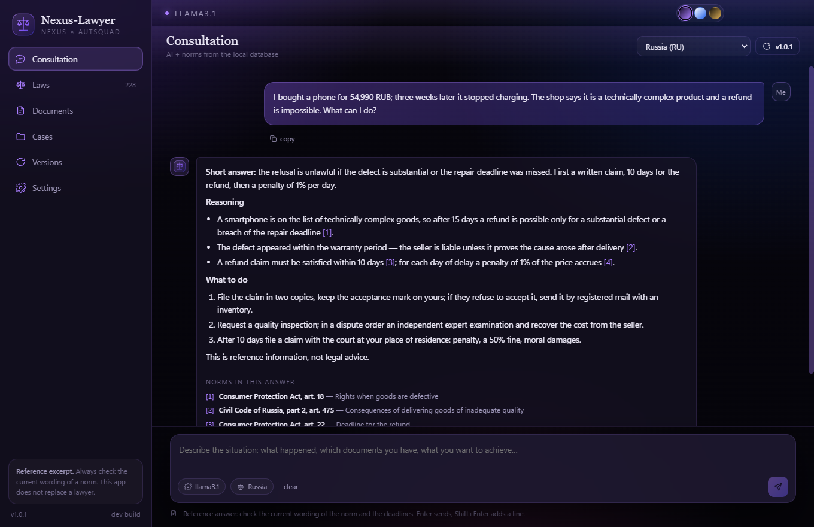
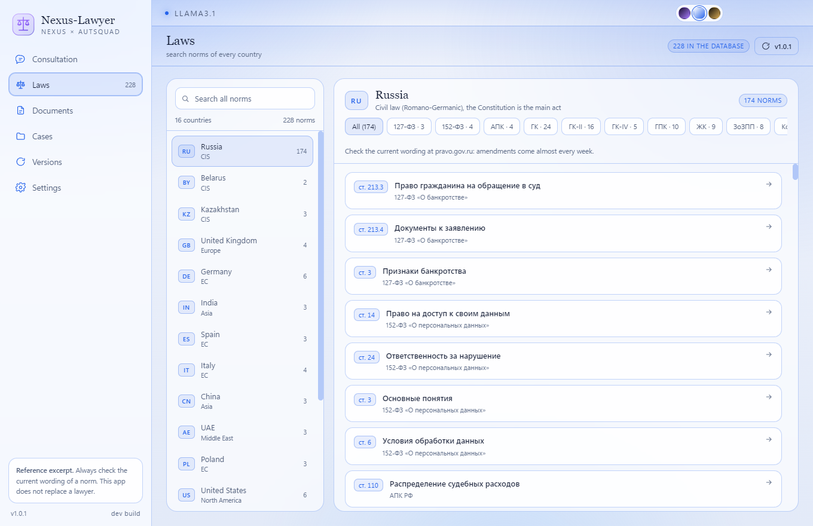
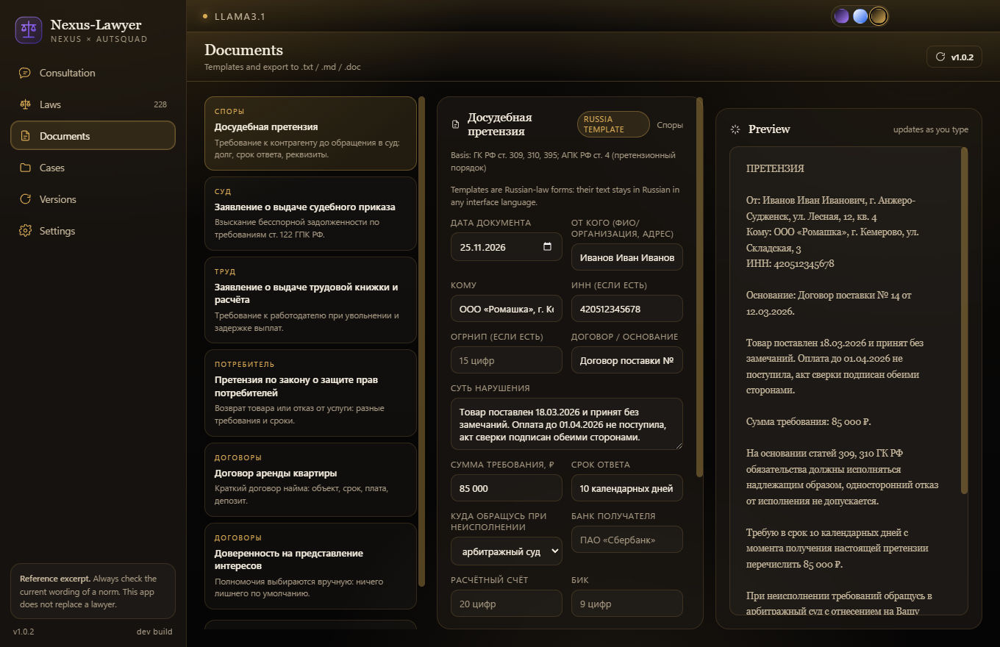
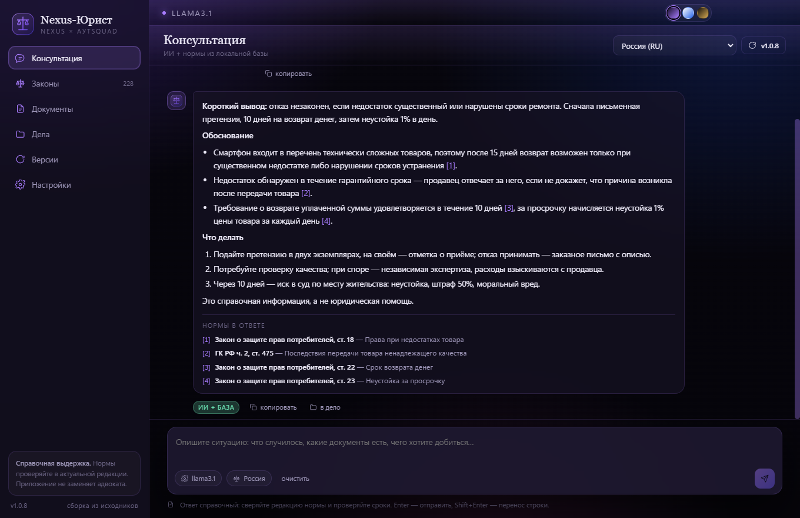

# Nexus-Lawyer

**English** · [Русская версия →](README.md)

A legal assistant with a local law database and a connected AI model. Part of the **Nexus × АутSquad** ecosystem.

We do not replace a lawyer: the app gives you the norms, the structure of a claim and the next steps, and a human makes the decision.

The interface is bilingual — Russian and English, switching is instant and needs no restart.

| English interface | Русский интерфейс |
|---|---|
Three themes, the same across every Nexus app: Midnight (black + violet), Ivory (white + blue), Aurum (dark + gold). Screenshots show the English interface.

| Midnight | Ivory | Aurum |
|---|---|---|
|  |  |  |

| Settings | Russian interface |
|---|---|
|  |  |

## Interface language

- The **RU / EN** switch lives in Settings, in the Interface block. It applies instantly: menus, headings, buttons, hints, errors and placeholders all change.
- The choice is stored in `localStorage` (`nl-lang`) and in the settings file, so the next launch opens in the selected language. Russian is the default.
- The answer language is its own Answer language option: the interface can be English while explanations are Russian (or the other way round), plus German.
- Document templates (`electron/docs.ts`) are Russian-law forms: with another country selected the screen disables export until the user confirms the document is prepared under Russian law. The wording of norms (`resources/laws/*.json`) stays in the language of that law.
- The demo conversation on the Consultation screen is served in the selected language as well.

## What it does

- **Consultation.** An answer with references to articles: the model receives excerpts from the local database (RAG) and must cite the norms. Without a model the reference mode still finds the relevant norms for a query.
- **Laws.** 16 countries, 228 norms: the Russian Constitution, civil, labour, criminal, administrative, housing, family, tax and procedural codes, consumer protection, BGB, Code civil, UCC, Limitation Act, Codice civile, Código Civil, KC, TBK, the civil codes of Kazakhstan, Belarus, Ukraine and China, Minpō, UAE and Indian law. The default country is “All countries”, so search covers the whole database rather than only Russia. Your own JSON packs are imported with schema validation, and the pack list can be reviewed and cleaned up.
- **Documents.** Six templates: pre-trial claim, court order application, labour application, consumer claim, lease agreement, power of attorney. Nothing is invented: an empty field stays as a “укажите” marker, and export buttons stay disabled until the required data is there. Amounts (`85 000`, `85,50`, `1 234 567,89`), dates, tax IDs, bank account and BIC are validated. Export to `.txt`, `.md`, `.rtf`.
- **Cases.** Cards with client, status, notes and attachments. An unsaved draft survives switching sections and a version conflict never overwrites your edits. Everything stays local in `%APPDATA%\Nexus-Юрист`.
- **Three themes.** Midnight (black + violet), Ivory (white + blue), Aurum (graphite + gold). Glassmorphism, no generic AI-looking default.
- **Model of your choice.** Ollama, llama.cpp, Ada 4B (127.0.0.1:8090), Nexus-Harness (:8848) or any OpenAI-compatible API, cloud included.

## Install

| Format | File | Folder |
|---|---|---|
| Portable exe | `nexus-lawyer-1.0.7-portable.exe` | `release-portable-exe/` |
| Portable zip | `nexus-lawyer-1.0.7-portable.zip` | `release-portable-zip/` |
| NSIS installer | `nexus-lawyer-setup-1.0.7.exe` | `release-installer/` |

The portable builds only need to be unpacked and run — they do not touch the registry. The installer puts the app into the user profile (no administrator rights), creates shortcuts and supports auto-updates.

From source:

```bash
npm install
npm run dev      # Vite + Electron
npm run build    # main + renderer
```

## Updates and release repository

- `electron-updater` with the GitHub provider (`roma1231jjj-cpu/nexus-lawyer`) or a custom generic server (the Custom update server field in Settings).
- `stable` / `beta` (prerelease) channels.
- The version log lives in `resources/versions.json` and is shown in the Versions tab.
- Every build is copied to `versions/v<version>/` together with a manifest and SHA-256.
- The `latest.yml` update metadata is generated when the installer is built.
- Auto-update works in the installed build (in-app download, install, restart). Portable builds are updated by replacing the exe — use the “releases on GitHub” button in the Versions tab.

To ship an update:

```bash
# bump the version in package.json and add an entry to resources/versions.json
npm run dist
# then upload the files from release-installer/ to GitHub Releases
#   nexus-lawyer-setup-<version>.exe
#   nexus-lawyer-setup-<version>.exe.blockmap
#   latest.yml
```

## Development

```bash
npm install
npm run dev      # Vite + Electron
npm run build    # main + renderer
npm run shots    # 9 screenshots (three themes, RU/EN)
npm test         # 13 tests: search, import, prompt, answer stream
npm run dist     # portable exe + portable zip + installer
```

Stack: Electron 33, React 18, TypeScript, Vite, electron-builder. No native dependencies.

Localization layer: `src/i18n/ru.ts` and `src/i18n/en.ts` (the key type is derived from the Russian dictionary), `src/i18n/index.ts` — `t()`, `useT()`, `useLang()`, locale-aware date formatting. The main process uses `electron/i18n/` (model prompt, reference answer, dialogs, updater messages).

Open the interface in a plain browser (no Electron): `npx vite --port 5182`. When `window.nexus` is missing, the renderer starts the demo bridge `src/mock.ts` and reads the law database straight from `resources/laws/*.json` — handy for layout work and screenshots.

## Layout

```
electron/        main, preload, law database, AI client, templates, updater, i18n
src/             renderer: App, views, i18n, themes, CSS
resources/laws/  law packs (JSON), read at runtime
resources/       versions.json — version log
build/           icons, rcedit resources for the exe
scripts/         main build, artifacts, screenshots, icon
docs/screenshots RU/EN screenshots for the READMEs
versions/        release manifests and artifact copies (local)
```

## Law pack format

```json
{
  "countries": [{ "code": "KZ", "name": "Kazakhstan", "flag": "🇰🇿", "region": "CIS", "system": "…", "languages": "…", "note": "…" }],
  "articles": [{ "id": "kz-gk-178", "country": "KZ", "code": "Civil Code of Kazakhstan", "codeShort": "CC KZ", "number": "art. 178", "title": "…", "text": "…", "tags": ["limitation"] }]
}
```

Import: Laws tab → “Import a pack”. Packs are validated against the schema: records without `number`/`title`/`text` are dropped with a message, and a broken file never damages the database.

## What the app does not do

- It does not invent requisites, amounts, city or dates — anything missing stays as a marker.
- It does not certify that a norm is current: excerpts carry no “verified” status, so the app keeps reminding you to check the official text (pravo.gov.ru and equivalents).
- It does not draft documents under foreign law: the templates are Russian, export for another jurisdiction requires explicit confirmation, while norms and explanations cover every country in the database.

## License

Code is MIT. The wording of norms is a reference excerpt — always check the current edition on the official portals.

Nexus × АутSquad, 2026.
