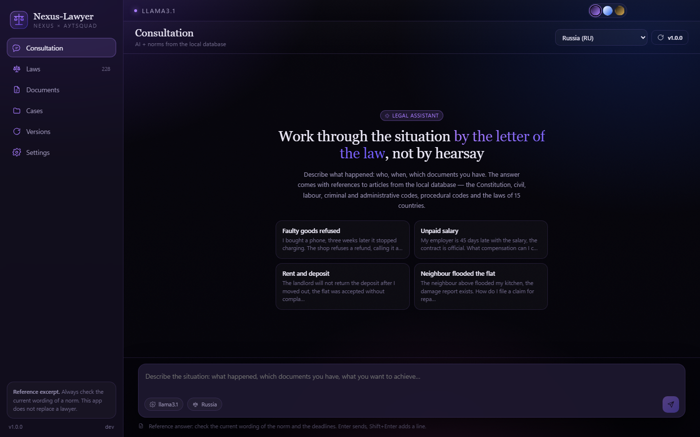
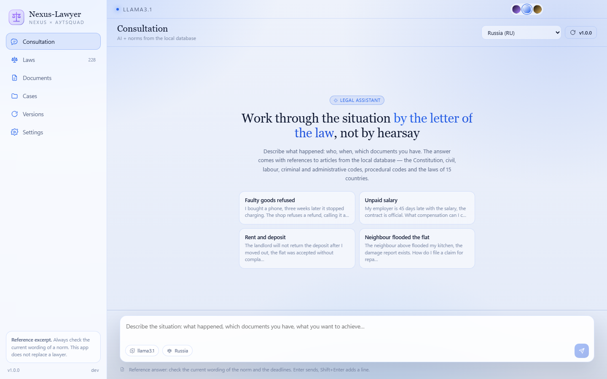
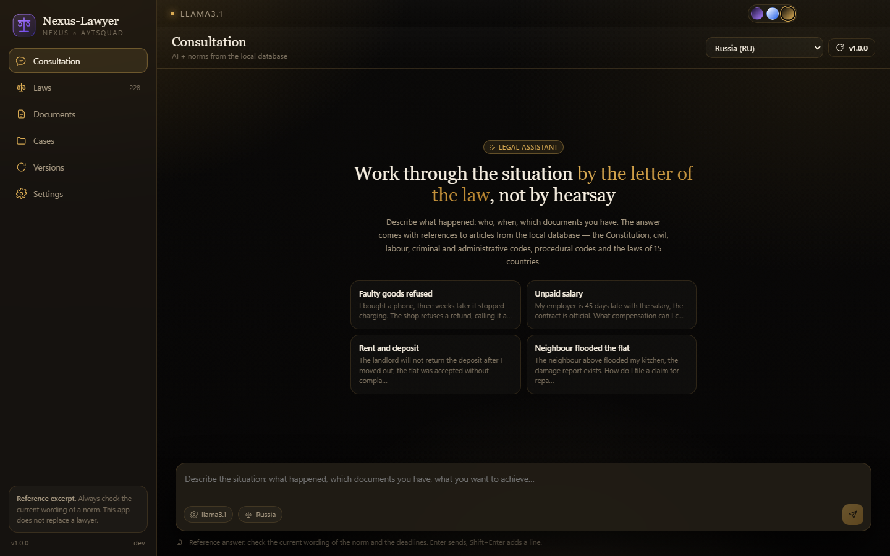
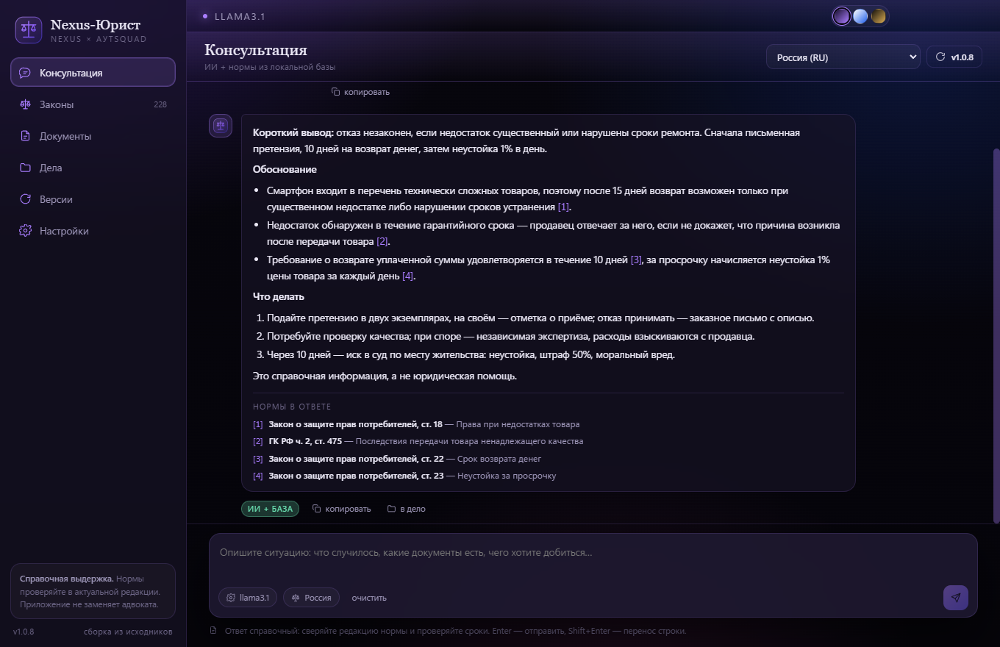
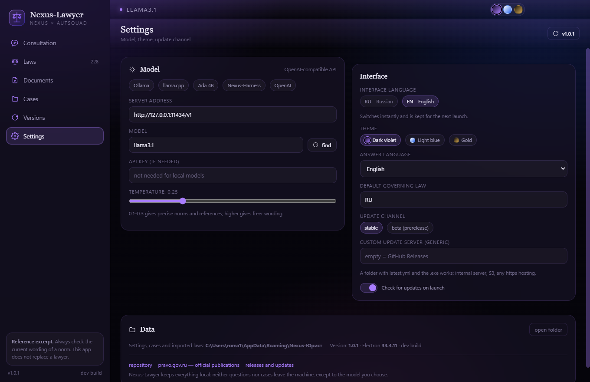

# Nexus-Юрист

[English version →](README.en.md) · **Русский**

Правовой помощник с локальной базой законов и подключённой моделью ИИ. Часть экосистемы **Nexus × АутSquad**.

Не заменяет адвоката: даёт нормы, структуру требований и шаги, а решение принимает человек.

Интерфейс двуязычный — русский и английский, переключение мгновенное, без перезапуска.

Три темы, как во всех приложениях Nexus: Midnight (чёрный + фиолетовый), Ivory (белый + синий), Aurum (тёмный + золотой). Скриншоты — английский интерфейс.

| Midnight | Ivory | Aurum |
|---|---|---|
|  |  |  |

| Русский интерфейс | Настройки, English |
|---|---|
|  |  |

## Язык интерфейса

- Переключатель **RU / EN** — в «Настройках», блок «Интерфейс». Работает мгновенно: меняются меню, заголовки, кнопки, подсказки, ошибки и плейсхолдеры.
- Выбор сохраняется в `localStorage` (`nl-lang`) и в файле настроек, поэтому следующий запуск открывается на выбранном языке. По умолчанию — русский.
- Переключение интерфейса заодно задаёт язык ответов модели; отдельный пункт «Язык ответов» позволяет держать интерфейс на английском, а ответы — на русском, английском или немецком.
- Формы российского права (`electron/docs.ts`) и тексты норм (`electron/laws.ts`, `resources/laws/*.json`) остаются на русском при любом языке интерфейса — это содержание права РФ, а не подписи. В английском интерфейсе раздел «Documents» показывает об этом отдельную строку.
- Демо-диалог на экране «Консультация» тоже двуязычный: он подставляется на выбранном языке.

## Что умеет

- **Консультация.** Ответ по делу со ссылками на статьи: модель получает выдержки из локальной базы (RAG) и обязана цитировать нормы. Без модели работает справочный режим — подбор норм по запросу.
- **Законы.** 16 стран, 228 норм: Конституция РФ, ГК, ТК, УК, КоАП, ЖК, СК, ЗоЗПП, НК, УПК, ГПК, АПК, 127-ФЗ, 152-ФЗ, BGB, Code civil, UCC, Limitation Act, Codice civile, Código Civil, KC, TBK, ГК РК/РБ, ЦК Украины, ГК КНР, Minpō, право ОАЭ и Индии. Поиск по всем странам, импорт своих пакетов JSON.
- **Документы.** Шесть шаблонов: претензия, судебный приказ, трудовое заявление, потребительская претензия, договор аренды, доверенность. Поля подставляются в текст, выгрузка в `.doc`, `.md`, `.txt`.
- **Дела.** Карточки с клиентом, статусом, заметками и вложениями. Всё локально в `%APPDATA%\nexus-lawyer`.
- **Три темы.** Midnight (чёрный + фиолетовый), Ivory (белый + синий), Aurum (графит + золото). Glassmorphism, без «нейрослопного» дефолта.
- **Модель на выбор.** Ollama, llama.cpp, Ada 4B (127.0.0.1:8090), Nexus-Harness (:8848) или любой OpenAI-совместимый API, включая облачный.

## Установка

| Формат | Файл | Папка |
|---|---|---|
| Portable exe | `nexus-lawyer-1.0.0-portable.exe` | `release-portable-exe/` |
| Portable zip | `nexus-lawyer-1.0.0-portable.zip` | `release-portable-zip/` |
| Установщик NSIS | `nexus-lawyer-setup-1.0.0.exe` | `release-installer/` |

Портативные сборки достаточно распаковать и запустить — они не пишут в реестр. Установщик ставит приложение в пользовательский профиль (без прав администратора), создаёт ярлыки и поддерживает автообновление.

Из исходников:

```bash
npm install
npm run dev      # Vite + Electron
npm run build    # main + renderer
```

## Обновления и репозиторий версий

- `electron-updater` с провайдером GitHub (`roma1231jjj-cpu/Nexus--lawyer`) или своим generic-сервером (поле «Свой сервер обновлений» в настройках).
- Каналы `stable` / `beta` (prerelease-релизы).
- Журнал версий — `resources/versions.json`, отображается во вкладке «Версии».
- Каждая сборка складывается в `versions/v<версия>/` с манифестом и SHA-256.
- Метаданные обновления `latest.yml` формируются автоматически при сборке установщика.
- Автообновление работает в установленной версии (in-app: скачивание, установка, перезапуск). Портативные сборки обновляются заменой exe — кнопка «релизы на GitHub» во вкладке «Версии».

Чтобы выпустить обновление:

```bash
# поднять версию в package.json и добавить запись в resources/versions.json
npm run dist
# затем выложить в GitHub Releases файлы из release-installer/
#   nexus-lawyer-setup-<версия>.exe
#   nexus-lawyer-setup-<версия>.exe.blockmap
#   latest.yml
```

## Разработка

```bash
npm install
npm run dev      # Vite + Electron
npm run build    # main + renderer
npm run shots    # 5 скриншотов в screenshots/ (три темы)
npm run dist     # portable exe + portable zip + установщик
```

Стек: Electron 33, React 18, TypeScript, Vite, electron-builder. Нативных зависимостей нет.

Слой локализации: `src/i18n/ru.ts` и `src/i18n/en.ts` (тип ключей выводится из русского словаря), `src/i18n/index.ts` — `t()`, `useT()`, `useLang()`, форматирование дат по локали. Для главного процесса — `electron/i18n/` (промпт модели, справочный ответ, диалоги, сообщения апдейтера).

Открыть интерфейс в обычном браузере (без Electron): `npx vite --port 5182`. Если `window.nexus` нет, рендерер поднимает демо-мост `src/mock.ts` и читает базу законов прямо из `resources/laws/*.json` — удобно для правки вёрстки и скриншотов.

## Структура

```
electron/        main, preload, база законов, ИИ-клиент, шаблоны, апдейтер, i18n
src/             renderer: App, views, i18n, темы, CSS
resources/laws/  пакеты законов (JSON), читаются в рантайме
resources/       versions.json — журнал версий
build/           иконки, rcedit для ресурсов exe
scripts/         сборка main, артефактов, скриншоты, иконка
docs/screenshots скриншоты RU/EN для README
versions/        манифесты выпусков и копии артефактов (локально)
```

## Формат пакета законов

```json
{
  "countries": [{ "code": "KZ", "name": "Казахстан", "flag": "🇰🇿", "region": "СНГ", "system": "…", "languages": "…", "note": "…" }],
  "articles": [{ "id": "kz-gk-178", "country": "KZ", "code": "ГК РК", "codeShort": "ГК РК", "number": "ст. 178", "title": "…", "text": "…", "tags": ["давность"] }]
}
```

Импорт: вкладка «Законы» → «Импорт пакета».

## Лицензия

Код — MIT. Тексты норм — справочные выдержки, сверяйте редакцию на официальных порталах.

Nexus × АутSquad, 2026.
